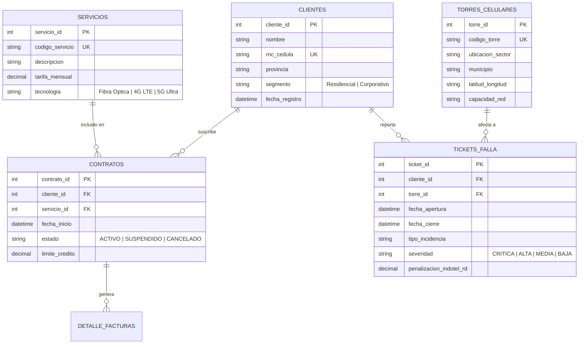

# 📡 Ecosistema de Bases de Datos & Pipeline Lógico Multi-Motor
### Plataforma de Evaluación Técnica, Arquitectura de Datos y Certificación Profesional en Telecomunicaciones (Claro Dominicana & INDOTEL)

[](https://juancitopena.github.io/prueba-tecnica-sql-telecom-multimotor/)
[](https://www.microsoft.com/sql-server)
[](https://www.postgresql.org/)
[](https://www.mysql.com/)
[](https://www.oracle.com/database/)
[](https://github.com/JUANCITOPENA)
[](LICENSE)

---

## 🎯 Resumen Ejecutivo

Este proyecto representa una solución integral de **ingeniería de datos, pruebas técnicas para desarrolladores/DBAs senior y entorno de certificación interactiva**. Simula la infraestructura de misión crítica de un operador de telecomunicaciones líder (**Claro Dominicana**) bajo la estricta regulación y auditoría de calidad de servicio del ente regulador (**INDOTEL**).

A través de una arquitectura desacoplada y una interfaz visual **Neo-Brutalista moderna (ancho 75% centrado)**, la plataforma implementa:
1. **Pipeline DDL Multi-Motor Completo:** Scripts idénticos y funcionalmente nativos para **Microsoft SQL Server, PostgreSQL, MySQL y Oracle Database**.
2. **Motor de Poblado Masivo (Data Seeder):** Procedimientos almacenados y bloques anónimos que generan dinámicamente más de **1,000 registros transaccionales realistas** (clientes residenciales/corporativos, contratos vigentes, torres celulares 4G/5G, llamadas CDRs, consumos de datos y tickets de avería con cálculo de penalizaciones por incumplimiento de SLAs).
3. **Showcase de 30 Consultas Técnicas de Entrevista:** 15 consultas fundamentales (DDL, DML, agregaciones, JOINs) y 15 consultas avanzadas de nivel Enterprise (Window Functions, CTEs recursivas, PIVOT, análisis de churn, detección de fraude y reportería regulatoria).
4. **Simulador de Examen Técnico Interactivo:** Sistema de evaluación cronometrado (30 minutos) con un banco rotativo de **100 preguntas técnicas**, barajado aleatorio de opciones (Fisher-Yates) para evitar patrones de respuesta y retroalimentación pedagógica instantánea.
5. **Generador Dinámico de Certificados Profesionales:** Certificación digital emitida en tiempo real firmada por el **Ing. Juancito Peña (CEO de DataIADev.com)**, con exportación dual a imagen PNG de alta fidelidad y documento vectorial PDF (A4 apaisado a una sola página) mediante `html2canvas` y `jsPDF`.
6. **Terminal Matrix & Manifiesto Técnico:** Efecto de lluvia digital Matrix interactiva con un manifiesto de maestría en bases de datos y 10 consejos de oro para entrevistas laborales.

🌐 **Despliegue en Producción (GitHub Pages):** [https://juancitopena.github.io/prueba-tecnica-sql-telecom-multimotor/](https://juancitopena.github.io/prueba-tecnica-sql-telecom-multimotor/)

---

## 🏗️ Arquitectura del Modelo Relacional

El modelo de datos modela un flujo de operaciones de telecomunicaciones con integridad referencial estricta, restricciones `CHECK`, claves primarias compuestas y campos de auditoría regulatoria:



---

## 📁 Estructura del Repositorio

El código fuente respeta una **separación estricta de responsabilidades (Separation of Concerns)**:

```text
├── index.html                   # Interfaz de usuario principal (Neo-Brutalism 75% centrado)
├── .gitignore                   # Exclusiones seguras de Git
├── README.md                    # Documentación técnica maestra
├── STATUS_PROYECTO_ECOSISTEMA_DB.md # Auditoría de estado y registro arquitectónico
│
├── css/                         # Hojas de estilo modulares
│   ├── styles.css               # Estilos principales, layout 75%, badges y animaciones
│   ├── quiz.css                 # Interfaz interactiva del simulador de examen
│   ├── certificate.css          # Maquetación y sello holográfico del certificado
│   └── matrix.css               # Estilos de la terminal digital Matrix
│
├── js/                          # Lógica JavaScript desacoplada
│   ├── main.js                  # Inicialización general, prism highlighter y navegación
│   ├── massive-insert.js        # Motor de cambio dinámico de scripts DDL y seeder masivo
│   ├── queries-showcase.js      # Catálogo dinámico de las 30 consultas técnicas con teoría
│   ├── questions-bank.js        # Banco maestro de 100 preguntas de entrevista técnica
│   ├── quiz-engine.js           # Motor del examen (temporizador, rotación Fisher-Yates, scoring)
│   ├── certificate.js           # Exportador dual (PNG + PDF vectorial A4 landscape 297x210mm)
│   └── matrix-terminal.js       # Efecto lluvia Matrix en Canvas 2D y typing de manifiesto
│
├── sql/                         # Scripts SQL ejecutables en producción
│   ├── Claro_Telecom_SQLSERVER_MASTER_COMPLETO.sql # Pipeline All-in-One SQL Server 2022
│   ├── Claro_Telecom_POSTGRES_MASTER_COMPLETO.sql  # Pipeline All-in-One PostgreSQL 16
│   ├── Claro_Telecom_MYSQL_MASTER_COMPLETO.sql     # Pipeline All-in-One MySQL 8.0
│   ├── Claro_Telecom_ORACLE_MASTER_COMPLETO.sql    # Pipeline All-in-One Oracle 21c XE
│   ├── seed_sqlserver_massive.sql                  # Seeder procedimental T-SQL
│   ├── seed_postgres_massive.sql                   # Seeder procedimental PL/pgSQL
│   ├── seed_mysql_massive.sql                      # Seeder procedimental MySQL Stored Procedure
│   └── seed_oracle_massive.sql                     # Seeder procedimental PL/SQL
│
└── assets/                      # Recursos multimedia y branding
    ├── LOGO_DATAIADEV.png       # Logotipo institucional DataIADev (3:1 ratio)
    └── certificado_premium.webp # Imagen base de acreditación
```

---

## 🚀 Instalación y Despliegue Local de Motores de Base de Datos

Cada motor cuenta con dos vías de despliegue claramente diferenciadas:

### 1. Microsoft SQL Server 2022 Developer & SSMS
* **Vía Windows Nativa (PowerShell):**
  ```powershell
  cd "$env:USERPROFILE\Downloads"; curl.exe -o SQL2022-Dev.exe -L "https://go.microsoft.com/fwlink/p/?linkid=2215158"; Start-Process ".\SQL2022-Dev.exe"
  ```
* **Vía Docker:**
  ```bash
  docker run -d --name claro-sqlserver -p 1433:1433 -e "ACCEPT_EULA=Y" -e "MSSQL_SA_PASSWORD=ClaroTelecom2026!*" mcr.microsoft.com/mssql/server:2022-latest
  ```

### 2. PostgreSQL 16+ & pgAdmin 4
* **Vía Windows Nativa (PowerShell con bypass de runtime):**
  ```powershell
  cd "$env:USERPROFILE\Downloads"; curl.exe -o postgres-setup.exe -L "https://get.enterprisedb.com/postgresql/postgresql-16.4-1-windows-x64.exe"; Start-Process ".\postgres-setup.exe" -ArgumentList "--install_runtimes 0"
  ```
  *(Nota técnica: El parámetro `--install_runtimes 0` evita colisiones cuando el sistema anfitrión ya cuenta con Microsoft Visual C++ 2022 instalado).*
* **Vía Docker:**
  ```bash
  docker run -d --name claro-postgres -p 5432:5432 -e POSTGRES_PASSWORD=ClaroPostgres2026! -e POSTGRES_DB=claro_ops_db postgres:16-alpine
  ```

### 3. MySQL 8.0 Community & Workbench
* **Vía Windows Nativa (PowerShell):**
  ```powershell
  cd "$env:USERPROFILE\Downloads"; curl.exe -o mysql-setup.msi -L "https://dev.mysql.com/get/Downloads/MySQLInstaller/mysql-installer-web-community-8.0.39.0.msi"; Start-Process ".\mysql-setup.msi"
  ```
* **Vía Docker:**
  ```bash
  docker run -d --name claro-mysql -p 3306:3306 -e MYSQL_ROOT_PASSWORD=ClaroMySQL2026! -e MYSQL_DATABASE=claro_ops_db mysql:8.0
  ```

### 4. Oracle Database 21c Express Edition (XE)
* **Descarga Oficial:** Extraer `setup.exe` de Oracle 21c XE y configurar contraseña para los usuarios `SYS` y `SYSTEM` en el puerto `1521`.
* **Vía Docker:**
  ```bash
  docker run -d --name claro-oracle -p 1521:1521 -e ORACLE_PASSWORD=ClaroOracle2026! gvenzl/oracle-xe:21-slim
  ```

---

## 📊 Las 30 Consultas de Entrevista Técnica

La plataforma desglosa las 30 consultas técnicas esenciales clasificadas en dos niveles:

### Nivel 1: Los 15 Fundamentos Clave (Basic to Intermediate)
1. **SELECT & Proyecciones:** Selección de atributos clave y alias de columnas.
2. **Filtrado WHERE:** Operadores de comparación y evaluación de predicados nulos (`IS NULL`).
3. **Búsqueda con LIKE:** Filtros de patrones de texto (prefijos de teléfonos y RNC).
4. **Operadores IN y BETWEEN:** Rangos de fechas de emisión y listas de estados de ticket.
5. **Ordenamiento ORDER BY:** Jerarquía de ordenación ascendente y descendente.
6. **Agregación COUNT, SUM, AVG:** Facturación mensual total y consumo promedio de megabytes.
7. **Agrupación GROUP BY:** Volumen de tráfico telefónico por provincia.
8. **Filtrado de Grupos HAVING:** Identificación de sectores que superan el umbral de averías.
9. **INNER JOIN:** Cruce estricto de clientes con sus contratos activos.
10. **LEFT JOIN:** Detección de clientes sin consumo registrado en el periodo.
11. **RIGHT JOIN & FULL JOIN:** Auditoría de discrepancias de inventario de torres.
12. **Subconsultas Escalares:** Clientes cuyo gasto mensual supera el promedio nacional.
13. **Subconsultas con IN / EXISTS:** Correlación lógica de clientes con averías críticas.
14. **Control de Nulos (COALESCE / ISNULL / NVL):** Manejo defensivo de valores inexistentes.
15. **Expresiones CASE WHEN:** Segmentación dinámica de valor de cliente (Gold, Silver, Bronze).

### Nivel 2: Las 15 Consultas Avanzadas Empresariales (Advanced to Expert)
16. **ROW_NUMBER():** Identificación de la avería más reciente reportada por cada cliente.
17. **RANK() y DENSE_RANK():** Ranking de facturación corporativa con gestión de empates.
18. **NTILE(4):** Cuartiles de consumo de ancho de banda para tarificación dinámica.
19. **LAG() & LEAD():** Comparativo mes a mes (MoM) de incremento en minutos consumidos.
20. **Running Total (SUM OVER):** Facturación acumulada anual progresiva.
21. **Moving Average:** Media móvil de 7 días del volumen de tráfico para balanceo de carga.
22. **CTE Simple (Common Table Expressions):** Estructuración modular de métricas de facturación.
23. **CTE Recursiva:** Modelado de jerarquías organizacionales y rutas de ruteo de red.
24. **PIVOT Dinámico:** Matriz transpuesta de ingresos desglosados por tipo de servicio y provincia.
25. **UNPIVOT:** Normalización de matrices de auditoría técnica.
26. **Detección de Churn Predictivo:** Identificación de clientes en riesgo de cancelación.
27. **Detección de Fraude en CDRs:** Detección de llamadas simultáneas imposibles mediante geolocalización.
28. **Auditoría Regulatoria INDOTEL:** Cálculo automatizado de penalizaciones por caída de enlaces.
29. **Optimización con Índices Compuestos:** Demostración de reducción de lecturas lógicas (I/O).
30. **Control Transaccional con ACID (TRY...CATCH / Rollback):** Transferencia monetaria y activación de paquete con aislamiento transaccional.

---

## 🏆 Sistema de Certificación Profesional

El examen técnico evalúa el dominio práctico y conceptual del aspirante:
* **30 Preguntas Técnicas Aleatorias:** Extraídas de un banco de 100 reactivos calibrados.
* **Algoritmo de Rotación Fisher-Yates:** Las opciones de respuesta (A, B, C, D) se barajan en tiempo de ejecución para garantizar evaluaciones 100% justas.
* **Aprobación $\ge 80\%$:** Desbloquea la generación del certificado digital.
* **Firma Autorizada:** Ing. Juancito Peña, CEO de DataIADev.com.
* **Exportación de Alta Resolución:** Descarga en formato PNG o PDF vectorial (A4 landscape) listo para adjuntar en LinkedIn o portafolios técnicos de empleo.

---

## 👨‍💻 Autor y Contacto Profesional

**Ing. Juancito Peña**  
*Arquitecto de Soluciones de Datos, Especialista en Inteligencia Artificial & CEO de DataIADev.com*  
* Santo Domingo, República Dominicana
* **GitHub:** [https://github.com/JUANCITOPENA](https://github.com/JUANCITOPENA)
* **Plataforma:** [DataIADev.com](https://dataiadev.com)

---

## 📄 Licencia

Este proyecto se distribuye bajo la licencia **MIT**. Puedes utilizarlo libremente para fines educativos, preparación de entrevistas técnicas o implementación corporativa.
